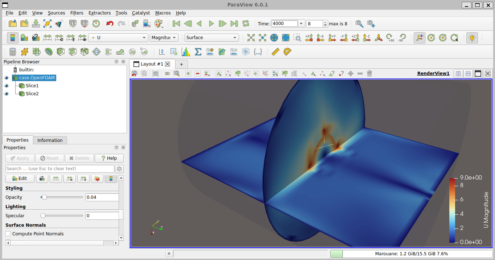
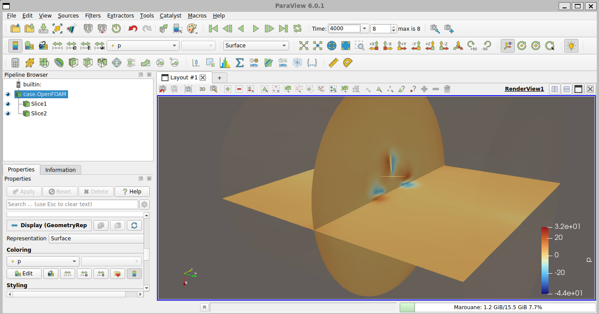

# OpenFOAM MRF Turbomachinery Starter

[](https://github.com/MarouaneLAMZIRAI/openfoam-mrf-turbomachinery/actions/workflows/tests.yml)
[](https://openfoam.org/version/14/)
[](LICENSE)
[](https://openfoam.org/download/windows/)

A reproducible, Windows-friendly educational project for running a steady
multiple-reference-frame (MRF) rotating-impeller simulation with OpenFOAM 14.

The repository also includes a transparent turbomachinery affinity-law
predictor and an optional data-fitted quadratic surrogate.

<p align="center">
  
</p>

> [!IMPORTANT]
> This is an educational numerical model—not a validated pump, turbine, or
> mixer design tool. Mesh independence and experimental validation are not
> included in the default workflow.

## Features

- Version-matched OpenFOAM Foundation MRF tutorial copied at runtime
- Windows batch launchers using Ubuntu under WSL2
- Automated OpenFOAM 14, ParaView, and Python setup
- Configurable impeller rotational speed
- Mesh, solver, log, and result verification
- Machine-readable JSON run summary
- ParaView visualization and post-processing utilities
- Turbomachinery affinity-law speed predictor
- Optional quadratic surrogate trained from user-supplied observations
- Python unit tests and GitHub Actions continuous integration

The OpenFOAM tutorial is **not bundled or relicensed**. It is copied from the
user's installed OpenFOAM 14 distribution when the working case is prepared.

## Verified example

The complete workflow was executed at **600 rpm** using OpenFOAM 14.

| Quantity | Recorded value |
| --- | ---: |
| Final time directory | `4000` |
| Mesh cells | `78,720` |
| Cell type | All hexahedral |
| Maximum aspect ratio | `7.51` |
| Maximum non-orthogonality | `24.54°` |
| Maximum skewness | `0.491` |
| Mesh status | `Mesh OK` |
| Reported power number | `2.85` |

See [RESULTS.md](RESULTS.md) for interpretation, field images, and scientific
limitations.

> [!NOTE]
> The values in `config/reference_operating_point.json` are illustrative
> predictor inputs. They were not extracted from the verified CFD run.

## Requirements

- Windows 10 or 11, 64-bit
- WSL2
- Ubuntu under WSL
- Administrator access when WSL or Ubuntu must be installed
- Internet access during the initial setup
- Approximately 8 GB of free disk space
- At least 8 GB of RAM recommended

The installer supports the Ubuntu releases provided for OpenFOAM 14:

- Ubuntu 22.04 — `jammy`
- Ubuntu 24.04 — `noble`
- Ubuntu 26.04 — `resolute`

OpenFOAM Foundation provides official instructions for running its Ubuntu
packages on Windows through WSL.

## Quick start on Windows

1. Download the project ZIP from **Releases**.
2. Extract it to a short path, for example:

   ```text
   C:\CFD\openfoam-mrf-turbomachinery
   ```

3. Run:

   ```text
   setup.bat
   ```

4. Use **Run as administrator** only if WSL or Ubuntu is not installed.
5. Restart Windows if requested.
6. Open Ubuntu once to complete its initialization.
7. Run `setup.bat` again.
8. Verify the installation:

   ```text
   verify.bat
   ```

9. Run the simulation:

   ```text
   run.bat
   ```

10. Open the results in ParaView:

    ```text
    visualize.bat
    ```

The Windows setup launcher performs Linux package installation through the WSL
`root` account. It does not request or store the user's Ubuntu password.

### Using another Ubuntu distribution name

The default WSL distribution name is `Ubuntu`.

If your distribution has another name, set it in PowerShell before running the
launcher:

```powershell
$env:MRF_WSL_DISTRO = "Ubuntu-24.04"
.\setup.bat
```

List the installed distributions with:

```powershell
wsl -l -v
```

## Generated directories

Simulation outputs are generated locally and excluded from Git:

```text
run/case/           Copied and parameterized OpenFOAM working case
results/logs/       Mesh, solver, and post-processing logs
results/report/     Machine-readable run summary
results/prediction/ Affinity-law prediction files
```

## Commands inside Ubuntu/WSL

From the repository directory:

```bash
bash scripts/setup_linux.sh
bash scripts/verify_linux.sh
bash scripts/run_linux.sh
bash scripts/postprocess_linux.sh
bash scripts/visualize_linux.sh
```

Remove generated cases and results with:

```bash
bash scripts/clean_linux.sh
```

The Windows equivalent is:

```text
clean.bat
```

## Change the rotational speed

Open `config/simulation.env` and edit:

```text
RPM=600
RECREATE_CASE=0
```

Set `RECREATE_CASE=1` when you want to reconstruct the case from a clean copy
of the official tutorial.

Return it to `0` afterward if you want subsequent runs to reuse the prepared
case.

When the RPM changes, the workflow automatically recreates the working case to
avoid accidentally reusing a solution generated at another rotational speed.

The parameterizer:

- Preserves an OpenFOAM `[rpm]` entry when present
- Converts RPM to radians per second when required
- Records the applied speed in the generated case
- Leaves the installed tutorial unchanged

## Prediction model

The predictor applies the classical same-machine affinity relationships:

- Flow rate:

  ```text
  Q/Q_ref = N/N_ref
  ```

- Pressure or head rise:

  ```text
  ΔP/ΔP_ref = (N/N_ref)²
  ```

- Torque:

  ```text
  T/T_ref = (N/N_ref)²
  ```

- Shaft power:

  ```text
  P/P_ref = (N/N_ref)³
  ```

Run a speed sweep from Windows:

```bat
predict.bat --rpm 300 450 600 750 900 --output results/prediction/speed_curve.csv
```

Before using the predictions for engineering decisions, replace the
illustrative values in:

```text
config/reference_operating_point.json
```

with a checked CFD-derived or experimental operating point.

Affinity laws do not automatically account for:

- Efficiency changes
- Cavitation
- Reynolds-number effects
- Strongly different operating regimes
- Changes in geometry
- Transient rotor–stator interactions

## Optional data-fitted surrogate

Prepare a CSV file containing at least six real CFD or experimental
observations:

```text
rpm,flow_rate_m3_s,pressure_rise_pa,torque_nm,power_w
```

Train the quadratic surrogate inside Ubuntu/WSL:

```bash
.venv/bin/python predictor/train_surrogate.py \
  --data my_sweep.csv \
  --output results/surrogate.json
```

The script refuses datasets with fewer than six observations and does not
generate synthetic training data.

A high training R-squared value is not evidence of predictive validity.
Independent validation cases should be retained.

## Visualization

After a successful simulation, run:

```text
visualize.bat
```

In ParaView:

1. Select `case.OpenFOAM`.
2. Select the latest time.
3. Click **Apply**.
4. Choose `U`.
5. Select **Magnitude**.
6. Rescale the color map to the current data range.

Useful visualizations include:

- Velocity-magnitude contours
- Pressure contours
- Orthogonal slices
- Velocity glyphs
- Streamlines
- Vorticity magnitude
- Q-criterion isosurfaces
- Clipped views of the impeller region

Generate vorticity and Q-criterion fields with:

```text
postprocess.bat
```

Detailed instructions are available in
[docs/VISUALIZATION.md](docs/VISUALIZATION.md).

<p align="center">
  
</p>

### Pressure interpretation

In incompressible OpenFOAM cases, `p` may represent kinematic pressure.

Confirm the field dimensions and fluid density before:

- Converting the field to pascals
- Comparing it with experimental pressure
- Labeling figures with pressure units

## Tests

Run the unit tests with:

```bash
python3 -m unittest discover -s tests -v
```

Validate all Bash scripts with:

```bash
for script in scripts/*.sh; do
  bash -n "$script"
done
```

The GitHub Actions workflow checks:

- Python source compilation
- Unit tests
- Bash syntax
- Supported Python versions

The continuous-integration workflow does not execute the complete CFD case
because the standard GitHub runner does not contain OpenFOAM 14.

## Scientific scope and limitations

- MRF is a steady rotating-frame approximation.
- Blade-passing interactions are not time-resolved.
- The selected tutorial represents a baffled mixing vessel.
- It is not a certified generic pump or turbine model.
- The supplied run does not include a mesh-independence study.
- No experimental validation is claimed.
- A successful solver run does not prove physical accuracy.
- `Mesh OK` confirms mesh-quality checks, not solution validation.
- Predictor results are only as reliable as their calibrated reference point.

For engineering or research use, add:

1. A systematic mesh-independence study
2. Residual and integral-monitor convergence monitoring
3. Experimental or trusted benchmark validation
4. Uncertainty analysis
5. Multiple operating points

## Troubleshooting

### No Ubuntu distribution is installed

Run PowerShell as administrator:

```powershell
wsl --install -d Ubuntu
```

Restart Windows if requested, open Ubuntu once, and rerun `setup.bat`.

### Another Ubuntu distribution name is installed

Set the distribution name:

```powershell
$env:MRF_WSL_DISTRO = "Ubuntu-24.04"
.\setup.bat
```

### OpenFOAM command not found

Rerun:

```text
setup.bat
verify.bat
```

### ParaView does not open

Confirm that WSLg is available.

If ParaView crashes during rendering, try:

```bat
set MRF_SOFTWARE_RENDERING=1
visualize.bat
```

### A clean simulation case is required

Run:

```text
clean.bat
```

Alternatively, temporarily set:

```text
RECREATE_CASE=1
```

in `config/simulation.env`.

## Citation

If this repository supports academic work, cite it using
[CITATION.cff](CITATION.cff).

## Attribution and license

The original orchestration scripts, prediction utilities, documentation, and
tests in this repository are released under the [MIT License](LICENSE).

OpenFOAM and its tutorials are separate GPL-licensed works developed by the
OpenFOAM Foundation.

See:

- [THIRD_PARTY_NOTICES.md](THIRD_PARTY_NOTICES.md)
- [SOURCES.md](SOURCES.md)

## Author

**Marouane LAMZIRAI**

CFD · Fluid Dynamics · Turbomachinery · Engineering Simulation

GitHub: [MarouaneLAMZIRAI](https://github.com/MarouaneLAMZIRAI)