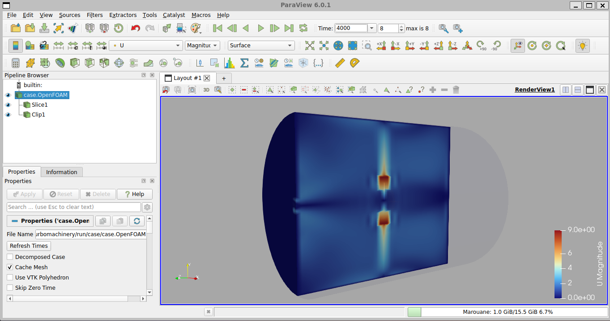
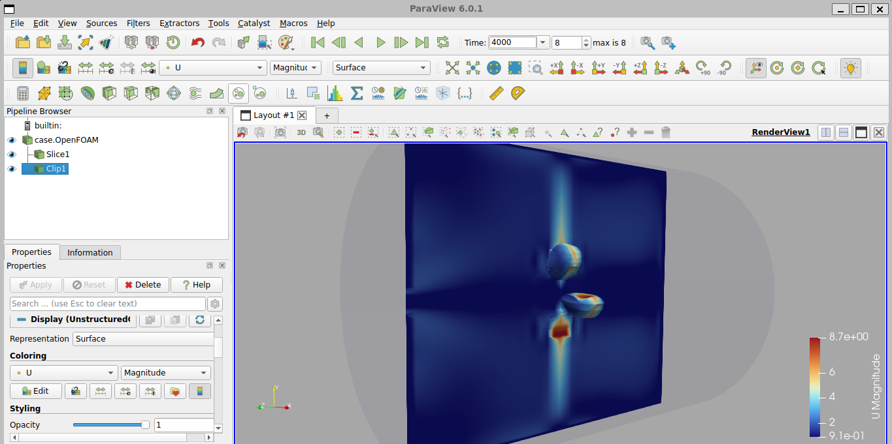

# Verified example results

## Purpose

This page records one successful execution of the repository workflow. It is
evidence that the starter can build and run its selected OpenFOAM 14 tutorial;
it is not an experimental validation or a mesh-independence study.

## Run configuration

| Item | Value |
| --- | --- |
| OpenFOAM | Foundation version 14 |
| Rotational speed | 600 rpm |
| Modelling approach | Steady multiple reference frame (MRF) |
| Working case source | Version-matched official rotating-impeller tutorial |
| Final time directory | 4000 |

## Mesh checks

| Metric | Result |
| --- | ---: |
| Cells | 78,720 |
| Cell type | 100% hexahedra |
| Regions | 1 |
| Maximum aspect ratio | 7.5096 |
| Average non-orthogonality | 2.0588 deg |
| Maximum non-orthogonality | 24.5393 deg |
| Maximum skewness | 0.4911 |
| OpenFOAM check | **Mesh OK** |

## Reported integral quantity

The tutorial reported:

```text
Power number = 2.85
```

This is the value printed by the executed tutorial workflow. It is not the same
as the illustrative torque, pressure-rise, flow-rate, or power values in
`config/reference_operating_point.json`.

## Field views

### Velocity magnitude


### Pressure field


### Mid-plane and clipped velocity views





## Interpretation limits

- The mesh passed OpenFOAM's quality checks, but a passing mesh is not proof of
  mesh-independent results.
- MRF provides a steady approximation and cannot resolve blade-passing
  transients.
- No experimental measurements are supplied for comparison.
- No uncertainty quantification is included.
- The case is a mixing-vessel tutorial, so the result must not be presented as
  a validated general pump or turbine characteristic.
- Pressure units must be checked from the OpenFOAM field dimensions before
  conversion or labeling.

Use this run as a reproducibility baseline. For engineering research, add at
least three systematically refined meshes, residual and integral-monitor
histories, and comparison against experimental or trusted benchmark data.
